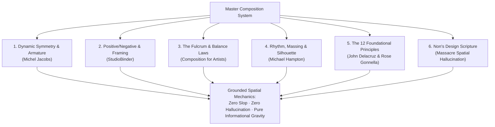

# The Composition Field Guide: Laws of Spatial Honesty, Dynamic Symmetry & Anti-Slop

> **A synthesis of the Ten Design & Composition Canons and Non's Design Scripture.**  
> Grounded in classical composition theory, dynamic symmetry, perceptual psychology, and the absolute prohibition of AI spatial hallucination and visual slop.

---

## 0. Creed & First Principles

> **"Compact first. Scroll only for interesting depth. Boxes fit content. Logos never boxed. Something must win. Eye enters on weight — payload sits on the exit. Name a grid or stay quiet. Whitespace is intentional or it is hallucinated. No slop ships."**

Spatial hallucination and AI design slop are not cosmetic failures. They are architectural failures:
1. **Spatial Hallucination** is an interface that invents reasons for things to occupy space instead of arranging them around how people read, choose, and act. It looks composed at first glance, but cannot explain its own geometry.
2. **AI Design Slop** is the default nobody chose: unanchored equal-weight cards, arbitrary stretch-to-fill boxes, floating unanchored columns, filler copy, decorative gradients/glass, and fake visual density.

Every spatial decision on a screen must answer one immutable question:
$$\mathbf{“Why\ is\ this\ here,\ why\ this\ size,\ and\ why\ this\ far\ from\ that?”}$$
If the answer is merely *“the grid put it there”* or *“to fill the container,”* the layout has failed.

---

## 1. The Classical Lineage: The Ten Source Studies

This system unifies ten fundamental texts and source treatises on visual composition:



### The Ten Pillars:
1. **Michel Jacobs (*The Art of Composition: Dynamic Symmetry*)**: The three lines of intention (Action/Diagonal, Dignity/Vertical, Rest/Horizontal); Root rectangles ($\sqrt{1}, \sqrt{2}, \sqrt{3}, \sqrt{4}, \sqrt{5}$ and the Golden Section $\Phi=1.618$); harmonic armatures and magnetic centers of vision.
2. **StudioBinder (*Elements of Composition: The Complete Guide*)**: 3 visual planes (foreground, midground, background); positive space vs negative space; pattern interruption; deep focus storytelling.
3. **Rose Gonnella (*Design Fundamentals: Visual Elements & Principles*)**: Elements (dot, line, shape, texture, space); Principles (scale, proportion, rhythm, emphasis, unity).
4. **John Delacruz (*The 12 Principles of Design*)**: Contrast, balance, emphasis, proportion, hierarchy, repetition, rhythm, pattern, white space, movement, variety, unity.
5. **Author Unknown (*Composition For Artists*)**: The single focal point rule; value structure; leading lines; chaos vs order; the seesaw fulcrum law; the binary rule of frame occupation (fill vs breathe).
6. **Michael Hampton (*Figure Drawing: Design and Invention*)**: Connective rhythm and flow vs static lumps; volume through wrapping axes; mass distribution; the silhouette test.
7. **Muryan Awaludin (*Fundamentals of Composition*)**: Form and space, pacing and contrast, layout styles, format and size.
8. **Cary Foster (*Vocabulary of Art Elements & Principles*)**: Structural definitions of space, value, and visual movement.
9. **Art and Design Foundation (*Section 8: Composition*)**: Golden mean subdivision and organic unity.
10. **Non Arkaraprasertkul (*THE BOOK: Design Scripture*)**: Massacre Spatial Hallucination (MSH layout & geo); the 40 hard commandments; glance path (Mustang pass vs Omega fail); kinetic grids; the B1–B18 ship gate.

---

## 2. Core Laws of Composition & Spatial Geometry

### Law 1: The Binary Law of Frame Occupation — "Fill or Breathe"
*(Source: Composition For Artists & StudioBinder)*

An element on an interface must strictly obey one of two states:
1. **Filling the Frame (Macro-Crop / Content Hug)**: The positive space commands the view. Padding is tight and proportional ($0.5\times$ to $1.5\times$ line height). There are no loose gaps. The viewer experiences immediate focus and direct engagement.
2. **Breathing Space (Active Directional Negative Space)**: Generous empty space exists *exclusively* where the viewer’s eye or the subject's gaze wants to go. It frames the subject, sets pacing, or gives weight to a focal point.

> [!CAUTION]
> **The Spatial Hallucination Middle Ground**: A box that is neither filling the frame nor providing purposeful breathing space. When an AI stretches a card to fill a CSS grid column, leaving accidental empty padding under short text, it has committed spatial hallucination.

### Law 2: The Fulcrum & Seesaw Principle of Asymmetrical Balance
*(Source: Michel Jacobs & Composition For Artists)*

Visual weight is physical. An interface is a lever balanced upon a central fulcrum (the viewer's center of vision):
$$\text{Visual Weight} = \text{Visual Mass} \times \text{Distance from Fulcrum}$$

- **Large quiet mass**: Lower contrast, muted tone, large physical area placed **near the center**.
- **Small dense accent**: High contrast, vivid chroma, dense informational cluster placed **further on the perimeter**.
- **The Hallucination Failure**: Placing a heavy element on one side and leaving the other side empty without an intentional counterweight, or placing three equal-weight cards side by side.

### Law 3: Harmonic Armatures & Dynamic Symmetry
*(Source: Michel Jacobs)*

Every division of the viewport must derive from a geometric proportion, never an arbitrary integer:
- **Root 1 ($\sqrt{1}$)**: The square ($1:1$) — stability, neutral grounding.
- **Root 2 ($\sqrt{2}$)**: ($1:1.414$) — the silver ratio, European paper standards (A4/A5).
- **Root 3 ($\sqrt{3}$)**: ($1:1.732$) — dynamic triangular division, high architectural energy.
- **Golden Section ($\Phi$)**: ($1:1.618$) — Sanzo Wada’s natural split: two colours split at $61.8\% / 38.2\%$.

When dividing screens, panels must dock along these armature lines. Arbitrary percentage splits ($50/50$, $25/25/25/25$) create dead, static layouts.

### Law 4: The Three Vectors of Visual Line
*(Source: Michel Jacobs)*

Every visual line carries innate psychological kinetics:
1. **Horizontal lines**: Rest, quiet, landscape, stability (ideal for reading grounds, stat strips).
2. **Vertical lines**: Dignity, structure, strength, columns (ideal for architectural boundaries, rails).
3. **Diagonal / Oblique lines**: Action, speed, tension, kinetic movement.

> [!IMPORTANT]
> Diagonal or rotated elements are **forbidden** unless explicitly locked to a named kinetic grid (`axial` or `radial`). Arbitrary tilts are pure visual slop.

### Law 5: The Silhouette Readability Test
*(Source: Michael Hampton)*

In classical figure design, a gesture is verified by filling the figure with flat black silhouette. If the action, volume, and balance are not immediately readable in pure black, the drawing is structurally unsound.

**Applied to UI Design:**
Squint at the page or convert all components to pure black-and-white silhouettes:
- Can you immediately distinguish what is primary, secondary, and tertiary?
- Is there one unmistakable focal point?
- Or do you see a generic, repetitive skyline of identical rounded cards?
If the silhouette is interchangeable with any SaaS landing page, the composition has failed.

---

## 3. Glance Path & Information Kinetic

### The Fundamental Axiom
> **The eye enters on visual weight, not DOM order. Put the message where the eye goes next — or the best copy in the world is worthless.**

```
FAIL (Omega Pattern - Spatial Hallucination)
┌──────────────────────────────────────────────┐
│ Headline (Weak, 20px)                        │  <-- Eye skips over this
├──────────────────────────────────────────────┤
│                                              │
│         HEAVY DOMINANT IMAGE / HERO          │  <-- Eye lands here first
│                                              │
├──────────────────────────────────────────────┤
│ Body Copy & Action                           │  <-- Eye forced to leapfrog
└──────────────────────────────────────────────┘

PASS (Mustang Pattern - Natural Glance)
┌──────────────────────────────────────────────┐
│                                              │
│         HEAVY DOMINANT IMAGE / HERO          │  <-- 1. Eye enters here
│                                              │
├──────────────────────────────────────────────┤
│ HEADLINE ON THE EXIT (Unapologetic Scale)     │  <-- 2. Eye drifts down here
├──────────────────────────────────────────────┤
│ Supporting Payload + Primary Action          │  <-- 3. Eye executes action
└──────────────────────────────────────────────┘
```

### Glance Rules:
1. **Entry = Heaviest Visual**: Full-bleed image, live map ($\ge 60\%$), or enormous display number.
2. **Payload on Natural Exit**: Place the headline and primary CTA immediately below or beside the entry visual. Never force an upward climb.
3. **No Leapfrog**: Related headline and copy must stay on the same side of the visual.
4. **Keyboard Aligned to Glance**: Tab order must match the natural visual path.

---

## 4. The 40 Hard Commandments (Non's Design Scripture)

### Form & Geometry
1. **Boxes fit content**: Padding $\approx 0.5–1.5\times$ line-height. No fixed/`min-height` void under short text. Control/chip/stat $\le 2\times$ content width and $\le 1.6\times$ content height.
2. **No void**: No flat empty region over $\sim \frac{1}{3}$ of the first screen. No phone-width column floating on desktop.
3. **Compact first**: If the task fits one screen at **390×844** and **1440×900**, make it fit. Scroll is for interesting depth, never recovering from fat chrome.
4. **Massacre the first expansion**: Do not decorate the consequences of spatial hallucination.
5. **Something must win**: One clear focal point. Scale step $\ge 1.5–2\times$ (posters/display $5–10\times$).
6. **Logos never boxed**: No border, chip, tile, pill, shadow, or backing panel around a logo.
7. **Symbols over prose**: Compact marks (status dots, gauges, $\uparrow\downarrow$) where clear. Never emoji-as-UI-icon.
8. **Subtract before add**: Screen caps: $\le 15$ cards, $\le 3$ shadows, **one** radius (or none), $\le 5$ pills, $\le 8$ font sizes, **0** decorative gradients/glass.
9. **Map-first surgical table**: Map $\ge 60\%$ of screen on maps/ops; panels docked as edge instruments; nothing covers the map on load.
10. **Glance: payload on exit**: Entry = heaviest visual; headline + action sit on the natural exit.
11. **No leapfrog**: Headline and copy stay united on one side of a dominant visual.
12. **Image $\rightarrow$ Headline $\rightarrow$ Copy**: Reject Title $\rightarrow$ huge-image $\rightarrow$ copy when the image outweighs the title.
13. **Name a grid or stay quiet**: Use `radial`, `axial`, `column`, or `modular`. No arbitrary float.
14. **Intentional voids push**: Empty modules or columns are structural. Never plug them with filler cards.

### Color & Texture
15. **Quiet ground + $\le 2$ saturated accents**: Each accent has a job. Data colors spend an accent.
16. **Motion: snap / skeleton / hard cut**: No floaty dissolves or hover-scale on cards. Respect `prefers-reduced-motion`.
17. **Banned primary faces**: Inter, Poppins, Montserrat, Roboto, Open Sans, Lato, DM Sans, Space Grotesk, Geist, Plus Jakarta Sans, Manrope, Nunito, naked `system-ui`. Prefer Jost, Josefin Sans, League Spartan; Thai: Prompt or Kanit.
18. **Prose measure $\le 65\text{ch}$**: Body $45–75\text{ch}$; Thai/Chinese keep A4/A5 physical width ($\sim 30–45$ Chinese chars).

### Information Honesty
19. **No filler, no fake numbers**: Ban *Unlock / Seamless / Revolutionize / Streamline / Boost*. No lorem stats.
20. **Hero without data fails**: No hero over half the screen unless it *is* the data or map.
21. **Ship basics never waived**: Text contrast $\ge 4.5:1$ (3:1 at $\ge 24\text{px}$); phone taps $\ge 44\times 44\text{px}$; all `` have truthful `alt`; controls named; visible focus.
22. **Never invent lat/lng**: No vibe pins, no admin centroids, no midpoints, no $0,0$.
23. **Never invent `tip_cm` / depth**: Prose descriptions stay text. Rain mm $\neq$ flood depth.
24. **No silent geocode swaps**: Reject and log ambiguous names. Prefer null + needs-hand-pin.
25. **Gauges $\neq$ streets**: Do not relocate a street flood to a river gauge. Missing feed $\neq$ all-clear.
26. **Soft-cite honesty**: Agree before reporting; credit sources; date-range old data.
27. **Style is not slop**: Do not strip deliberate choices protected in `STYLE.md`.
28. **Off-grid spacing fails**: Spacing values must sit on the stated scale (4px / MoMA scale).
29. **Never self-review**: Builder $\neq$ auditor. Independent walk required.
30. **Preserve the product**: Do not "fix" by deleting features, renaming, or trend-swapping.
31. **MoMA alignment**: Edges align; 1px hairlines without stealing layout; radius 0 by default.
32. **Phone chrome stays thin**: Sticky bars fit contents; slim nav $\le 56\text{px}$.
33. **One primary action per screen**: Verb + object, sized to label.
34. **Stat tiles in a ruled strip**: Sized to text, never stretched equal grid tracks.
35. **No first-load modal**: Answer the question first.
36. **Light by default**: Dark mode only when used in the dark or stated in `STYLE.md`.
37. **Triage before fixing**: Heavy / light / none. Fix geometry/MSH first.
38. **Template test**: If a competitor’s name fits onto the page, push further.
39. **Real visuals only**: Zero generated AI hero illustrations.
40. **When unsure: null**: A blank pin is honest; a pretty wrong pin is a scar.

---

## 5. Refusal Duty: Exact Phrases

When prompted to violate these laws or accept slop, refuse without softening:

1. **Refuse MSH:** *"Boxes must fit content. This expands without a task reason — massacre the first expansion."*
2. **Refuse void/scroll:** *"Compact first. I will not ship forever-scroll through empty space."*
3. **Refuse boxed logo:** *"Logos are never boxed. Remove the chip/border/panel."*
4. **Refuse equal mush:** *"Nothing wins. Pick a focal point with a real type step."*
5. **Refuse glance fail:** *"Payload must sit on the exit of the heavy visual. Reorder — do not rewrite first."*
6. **Refuse leapfrog:** *"Headline and copy stay on the same side of the dominant visual."*
7. **Refuse unnamed kinetic:** *"Name `radial`/`axial`/`column`/`modular` or stay orthogonal."*
8. **Refuse slop fonts:** *"That face is banned as unexplained primary. Use house face or STYLE.md reason."*
9. **Refuse filler:** *"No Unlock/Seamless/Revolutionize. No fake stats."*
10. **Refuse self-review:** *"Builder $\neq$ auditor. A different agent must walk the checklist."*
11. **Refuse map buried:** *"Map-first: $\ge 60\%$ first screen; panels are instruments at the edge."*
12. **Refuse reflex motion:** *"No `transition-all`, hover-scale, or idle pulse on non-live chrome."*
