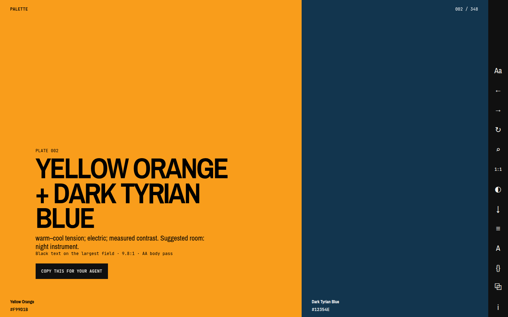
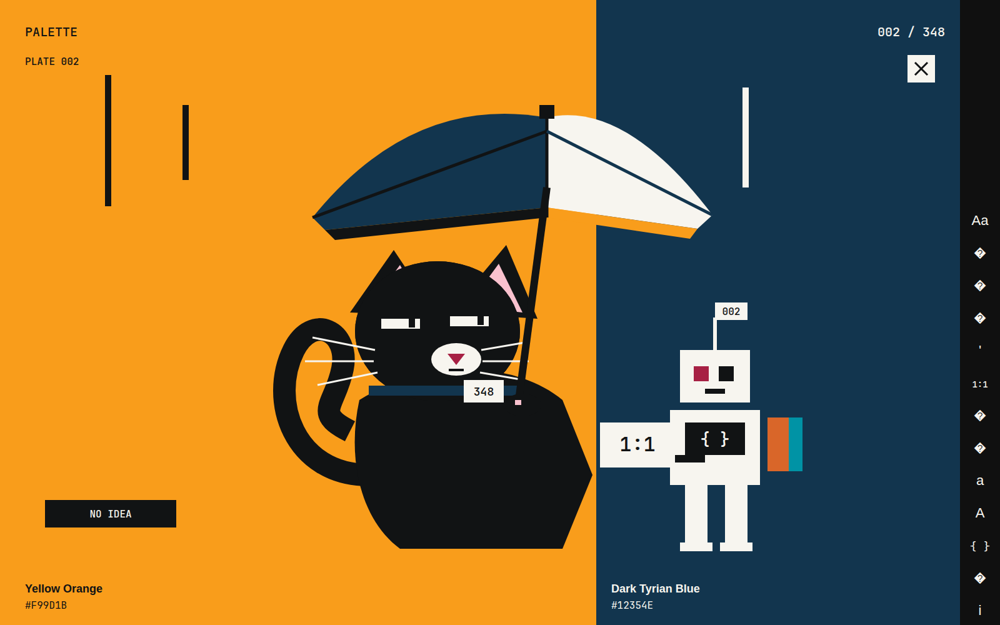

[English](README.md) · [简体中文](README.zh-CN.md) · ไทย

# Palette

ชุดสี 348 ชุดของซันโซ วาดะ เปิดทีละชุดจนเต็มจอ เครื่องมืออยู่ที่ขอบ



แผ่นที่ 002 Yellow Orange กับ Dark Tyrian Blue จากภาพที่ห้องนี้วาดบนเครื่อง ค่าฐานสิบหกบนพื้นสีคือค่าแปลงสำหรับจอที่มีที่มา ไม่ใช่การวัดหมึกที่พิมพ์

ที่อยู่สาธารณะคือ <https://colors.nonarkara.org/> สำเนาบน GitHub Pages อยู่ที่ <https://nonarkara.github.io/palette/>

## เข้าห้อง

เข้ามาพร้อมคำหนึ่งคำ ก็ได้ พร้อมอารมณ์ ก็ได้ หรือยังไม่มีอะไรในใจ ก็ได้

ประตูถามถึงความรู้สึก เป็นสี สถานที่ วัสดุ หรืองานที่จะเอาไปใช้ `calm ocean`, `red and black`, `minimalist website`, `สีแดงสีดำ`, `红色黑色`, ค่าฐานสิบหก หรือเลขแผ่น ล้วนเป็นคำค้นธรรมดา บนประตูมีอารมณ์ตั้งต้นหกคำ quiet, warm, punk, night, airy, earthy **NO IDEA — SURPRISE ME** เปิดห้องแบบสุ่ม เช่นเดียวกับ `↻`

การค้นอยู่บนเครื่องนี้ ไม่ได้เรียกโมเดล เลขแผ่น จะมีคำว่า plate หรือไม่ก็ได้ จะพาไปแผ่นนั้น ค่าฐานสิบหกจะเจอแผ่นที่ใช้ค่านั้น คลังคำมีชื่อสีภาษาอังกฤษ ไทย และจีน อักษรจีนตัวเต็มบางตัวถูกรับไว้เป็นคำพ้อง ข้อความจีนในห้องเป็นจีนตัวย่อ คำอังกฤษตั้งแต่สี่ตัวอักษรขึ้นไป ยอมให้ผิดหนึ่งตัวได้ก็ต่อเมื่อตรงกับคำพ้องเพียงคำเดียว ภาษาไทยและจีนจับคู่ตามที่เขียน รวมถึงการเขียนชื่อสีสองชื่อติดกัน ถ้าทุกคำที่มีความหมายตรง แผ่นเหล่านั้นจะมาก่อน ถ้าตรงเพียงบางคำ ผลลัพธ์จะบอกว่าเป็นชุดที่เกี่ยวข้อง คำที่ไม่มีใครตรง สามารถไม่คืนอะไรเลย

เมื่อความสัมพันธ์ลงตัว กด **COPY THIS FOR YOUR AGENT** มันคัดลอกบทสรุปให้โปรแกรมช่วยเขียน ตัวแปร CSS ที่มีชื่อ บทบาทของสี สัดส่วนที่ไม่เท่ากัน คำสั่งเรื่องคอนทราสต์ เส้นแบ่งที่มา บรรทัด MIT และที่อยู่คงที่ `https://colors.nonarkara.org/#plate-NNN` ปุ่ม `⧉` คัดลอกบทสรุปเดียวกัน วางลงในโปรแกรมช่วยเขียนได้เลย

`{}` เปิดแผ่นเดียวกันเป็น JSON (`palette-exhibition/1`) มีชื่อสี RGB ฐานสิบหก สัดส่วนที่ใช้ในห้องนี้ ค่าที่โปรแกรมอ่านให้ ข้อความสำหรับโปรแกรมช่วยเขียน และที่อยู่ ถ้าคลิปบอร์ดถูกกันไว้ ยังเลือกข้อความ JSON ได้

`↓` สร้าง PNG บนเครื่อง ไม่อัปโหลด โทรศัพท์ 1440 × 3120 แท็บเล็ต 2048 × 2732 คอมพิวเตอร์ 3840 × 2160 จะคงชื่อสี ค่าสี เลขแผ่น และเครดิตไว้ หรือจะปิดข้อความก็ได้ ไฟล์แนวตั้งวางสีซ้อนกัน ไฟล์แนวนอนวางสีข้างกัน แม้ห้องจะอยู่ในโหมดเทา ไฟล์ยังใช้ค่าแปลงเดิม โทรศัพท์อาจตัดภาพอีกทีหลังดาวน์โหลด

`1:1` เปิดตารางคอนทราสต์ที่ครึ่งล่างของจอ พื้นสียังเห็นอยู่ มันรายงานอัตราส่วนตาม WCAG 2.2 เป็นถ้อยคำ ตัวอักษรดำและขาวบนแต่ละพื้น (ตัวบท 4.5:1 ตัวใหญ่ 3:1) และรอยที่พื้นสองสีชนกัน (ตัวบท 4.5:1 ขอบที่ไม่ใช่ข้อความ 3:1) ตัวเลขที่แสดงปัดลงเหลือทศนิยมหนึ่งตำแหน่ง ผ่านหรือไม่ผ่านใช้อัตราส่วนที่ยังไม่ปัด จึงไม่มีการปัดขึ้นเพื่อให้ผ่าน ตารางเดียวกันจำลองโปรตาโนเปีย ดิวเทอราโนเปีย และไตรตาโนเปีย ด้วยเมทริกซ์ความรุนแรง 1.0 ของ Machado, Oliveira และ Fernandes ปี 2009 ในปริภูมิ sRGB เชิงเส้น หรือดูเป็นเทา ชื่อสีและฐานสิบหกยังเป็นค่าแปลงเดิม ภาพจำลองไม่ใช่การตรวจตา สิ่งที่ส่งออกคือค่าเดิม ไม่ใช่ภาพจำลอง ได้ทั้งตัวแปร CSS, Tailwind v4 แบบ `@theme` และ v3 แบบ `theme.extend.colors`, JSON ของโทเคน (`$type`, `$value`) หรือลิงก์ของแผ่น

`Aa` เปิด[ห้องอ่าน](reading.html)ในแท็บเดิม ว่าด้วยการจัดหน้า ตัวอักษร และบันทึกว่าอ่านอะไรไปแล้วจริง ฉบับยาวคือ [DESIGN-FIELD-GUIDE.md](DESIGN-FIELD-GUIDE.md) กับ [TYPOGRAPHY-FIELD-GUIDE.md](TYPOGRAPHY-FIELD-GUIDE.md) สองไฟล์นั้นเป็นภาษาอังกฤษ

วิธีใช้มีสามภาษา

- [PALETTE-FIELD-GUIDE.md](PALETTE-FIELD-GUIDE.md)
- [PALETTE-FIELD-GUIDE.zh-CN.md](PALETTE-FIELD-GUIDE.zh-CN.md)
- [PALETTE-FIELD-GUIDE.th.md](PALETTE-FIELD-GUIDE.th.md)

## รางเครื่องมือ

รางนี้คือชิ้นส่วนหน้าจอชิ้นเดียว ที่ความกว้างไม่เกิน 760px มันย้ายไปอยู่ขอบล่าง และเลื่อนไปด้านข้างได้ ทุกปุ่มเป็นปุ่มหรือลิงก์ กว้างยาวอย่างน้อย 44 × 44 พิกเซลซีเอสเอส และมีชื่อให้เทคโนโลยีสิ่งอำนวยความสะดวกอ่าน การเปลี่ยนแผ่นเคลื่อนไหว 260 มิลลิวินาที ถ้าเปิด `prefers-reduced-motion` แอนิเมชันและการเปลี่ยนสถานะจะถูกย่อจนแทบไม่มีความยาว

| เครื่องหมาย | ทำอะไร | แป้น |
|---|---|---|
| `Aa` | ห้องอ่าน แท็บเดิม | — |
| `←` | ความสัมพันธ์ก่อนหน้า | ลูกศรซ้าย |
| `→` | ความสัมพันธ์ถัดไป | ลูกศรขวา |
| `↻` | บังเอิญ | `R` |
| `⌕` | ค้น | `/` |
| `1:1` | คอนทราสต์ ภาพจำลองการเห็นสี รูปแบบสำหรับคัดลอก | `K` |
| `◐` | เทา เอาฮิวออก ชื่อสี ฐานสิบหก และอัตราส่วนยังผูกกับค่าแปลงเดิม | `C` |
| `↓` | PNG สำหรับวอลเปเปอร์ | — |
| `≡` | ดัชนี กรองได้เป็น 2, 3 หรือ 4 สี | `G` |
| `A` | ดร. นน งานวิจัย และการศึกษาแดง / ดำ | `A` |
| `{}` | JSON ที่พกไปได้ | `J` |
| `⧉` | บทสรุปชุดเดียวกับปุ่มที่มีข้อความ | — |
| `i` | หลักคิด และข้อความสั้นของดร. นน | `I` หรือ `?` |

ลูกศร `/` และตัวอักษรจะไม่ทำงานเมื่อมีแผ่นข้อความเปิดอยู่ กำลังพิมพ์ หรือกด Command, Control หรือ Alt ค้าง ทางลัดเหล่านั้นยังเป็นของเบราว์เซอร์

สีไม่ใช่ตัวบอกอย่างเดียว เลขแผ่น ชื่อสี ค่าที่อ่านได้ และบรรทัดคอนทราสต์ ยังเป็นข้อความ

## สิ่งที่ฉบับนี้เติม

หน่วยของวาดะคือความสัมพันธ์ ฉบับนี้ทำให้ความสัมพันธ์ใหญ่พอจะยืนอยู่ข้างใน และให้สีสอง สาม สี่ มีพื้นที่ไม่เท่ากัน สองสีถ่วงน้ำหนัก 1.618 ต่อ 1 ประมาณ 61.8 / 38.2 สามสีใช้ 1.45, 0.9 และ 0.65 สี่สีใช้ 1.55, 0.85, 0.7 และ 0.55 มีหนึ่งพื้นที่ยืนหลักไว้เสมอ สัดส่วนเหล่านี้เป็นของห้องนี้ ไม่ใช่กฎที่หยิบมาจากแผ่นพิมพ์

จากนั้นหน้าเว็บคำนวณค่าอ่านในเบราว์เซอร์

- อุณหภูมิ นำด้วยอุ่น นำด้วยเย็น หรือตึงระหว่างอุ่นกับเย็น (warm-led, cool-led, warm–cool tension)
- พลังงาน เงียบ ชัด หรือไฟแรง (quiet, clear, electric)
- ค่าความสว่าง สว่าง กลาง หรือมืด (light, mid-tone, dark)
- ช่วงความต่าง ค่าใกล้กัน ความต่างพอประมาณ หรือคอนทราสต์สูง (close values, measured contrast, high contrast)
- ห้องที่แนะนำ จากรายการปิด quiet editorial, domestic warmth, night instrument, botanical study, electric argument, mineral calm, confectionery shock, civic daylight, archival room

แผ่นที่ 002 ในภาพด้านบน แสดงบรรทัดนี้ ตึงระหว่างอุ่นกับเย็น ไฟแรง ความต่างพอประมาณ ห้องที่แนะนำคือ night instrument ค่าความสว่างถูกคำนวณด้วย และแผ่นนี้เป็นมืด คำนั้นไม่อยู่ในบรรทัดเดียวบนจอ ค่าเหล่านี้เป็นของดร. นน คำนวณแบบกำหนดผลได้ ไม่ใช่ถ้อยคำของวาดะ และไม่ได้เรียกเอพีไอ

`A` คือห้องวิจัย มีการศึกษากลุ่มสีส่วนตัว แดง `#A72144` กับดำ `#111314` ที่นั่นเรียกว่า classy and dangerous คู่นี้ไม่ได้อ้างว่าเป็นหนึ่งใน 348 ห้องเดียวกันเก็บลำดับสั้น ๆ ที่มีที่มาของซันโซ วาดะ (1883–1967) *South Wind* สมาคมมาตรฐานสีญี่ปุ่นในปี 1927 *Haishoku Sōkan* (1933–34) ซึ่งภายหลังพิมพ์ใหม่ในชื่อ *A Dictionary of Color Combinations* รางวัลออกแบบเครื่องแต่งกายสีสำหรับ *Gate of Hell* ในงานออสการ์ครั้งที่ 27 และบุคคลผู้มีคุณูปการทางวัฒนธรรม (Person of Cultural Merit) ในปี 1958 ลิงก์คือ [Art Platform Japan](https://artplatform.go.jp/artists/A2089), [บันทึกออสการ์](https://www.oscars.org/oscars/ceremonies/1955/C) และ [Seigensha](https://en.seigensha.com/books/978-4-86152-247-5/) ใจความฉบับสั้นกว่าอยู่ใน [ABOUT.md](ABOUT.md), [ABOUT.zh-CN.md](ABOUT.zh-CN.md) และ [ABOUT.th.md](ABOUT.th.md)

ข้อความหลัง `i` เขียนสามครั้ง อังกฤษ ไทย (`lang="th"` ด้วย IBM Plex Sans Thai ที่ไม่ใช้หัววน) และจีนตัวย่อ (`lang="zh-Hans"` ด้วย Noto Sans SC) ป้ายบนรางเป็นภาษาอังกฤษ ป้ายของวอลเปเปอร์มีครบสามภาษา

## ที่มา

ความสัมพันธ์มาจากซันโซ วาดะ [`dictionary-of-colour-combinations` ของ Matt DesLauriers](https://github.com/mattdesl/dictionary-of-colour-combinations) (MIT ลิขสิทธิ์ 2020) คือไฟล์ `data/colors.json` เขาแก้และจัดแพ็กเกจใหม่จากชุดที่ [Dain M. Blodorn Kim](https://github.com/dblodorn/sanzo-wada) รวบรวมไว้ก่อนหน้า ซึ่งก็เป็น MIT (ลิขสิทธิ์ 2024) โค้ดของ Kim ไม่อยู่ในคลังนี้ ค่า RGB และฐานสิบหกคือค่าแปลงสำหรับจอของชุดข้อมูลนั้น

ดร. นน (Non Arkaraprasertkul) เป็นผู้เลือกสัดส่วนพื้นที่ที่ไม่เท่ากัน เครื่องมือบนจอ คำค้น บทบาท แผนภาพ และค่าที่อ่านได้ ไม่มีความเกี่ยวข้องกับ Seigensha กองมรดกของวาดะ หรือผู้จัดทำข้อมูล เว็บนี้ไม่ทำสำเนาสแกน ปก หรือข้อความของสำนักพิมพ์

ตัวอักษรคือ Archivo Narrow (Omnibus-Type), IBM Plex Sans Thai (IBM), Noto Sans SC (Google) และ JetBrains Mono (JetBrains) ภายใต้ SIL Open Font License ขอจาก Google Fonts การขอนั้นคือที่อยู่ของไฟล์ฟอนต์ ไม่ใช่สคริปต์วิเคราะห์ หน้าเว็บมี Content-Security-Policy และไม่มีสคริปต์วัดผู้ใช้

คณิตของคอนทราสต์คือสูตรความสว่างสัมพัทธ์ของ WCAG 2.2 เมทริกซ์ภาพจำลองมาจาก Machado, Oliveira และ Fernandes ปี 2009 ทั้งสองอย่างไม่ใช่คำตัดสินเรื่องหนังสือที่พิมพ์ และภาพจำลองไม่ใช่การวินิจฉัย

หนังสือ บทความ และเว็บที่อ่านแล้วไม่ได้คัดลอก ระบุไว้ใน [CREDITS.md](CREDITS.md) และ[หน้าเครดิต](credits.html) รายชื่อนั้นไม่ใช่การรับรอง

สัญญาภาพสำหรับคนที่จะแก้ห้องนี้อยู่ที่ [context.md](context.md) เป็นภาษาอังกฤษ

## เปิดบนเครื่องตัวเอง

Python 3 เป็นตัวเสิร์ฟห้อง เปิด `index.html` เป็นไฟล์ตรง ๆ แล้ว JSON จะไม่โหลด

```bash
python3 -m http.server 4173
```

`npm run dev` สั่งคำสั่งนี้ เปิด <http://127.0.0.1:4173> หยุดด้วย Ctrl-C

Node.js ใช้สำหรับการตรวจ

```bash
npm run check
```

การตรวจตรึงชุดข้อมูลไว้ที่สีมีชื่อไม่ซ้ำ 159 สี และแผ่น 348 แผ่น แต่ละแผ่นมีสอง สาม หรือสี่สี คือ 120, 120 และ 108 นอกจากนี้ยังตรึงมาร์กอัปหลายภาษา บรรทัดที่มา และข้อห้ามเรื่องไล่เฉด เงา และร่องรอยอีกไม่กี่อย่าง มันตัดสินห้องไม่ได้

ก่อนปล่อย ควรเดินด้วยแป้นพิมพ์อย่างเดียว ซูม 200% ที่ความกว้าง 375, 768 และ 1280 พิกเซลซีเอสเอส เปิดโหมดลดการเคลื่อนไหว และค้นทั้งอังกฤษ ไทย จีน `npm run verify:browser` คือรอบที่มีสคริปต์ ต้องมี `npm ci` และ Chromium ของ Playwright ตัวห้องนิทรรศการไม่ต้องใช้สิ่งเหล่านี้

## สถานะ

ฉบับสาธารณะนี้คือ `0.1.0` ทำโดยดร. นน (Non Arkaraprasertkul) ร่วมกับ Codex Mama Rule คือให้ผู้ใหญ่ที่ไม่ทำงานสายเทคนิค เข้ามาครั้งแรก โดยไม่มีคนสอน ถ้าผ่านจึงจะติดแท็ก `1.0` การทดสอบนี้ยังไม่ได้ทำ คนที่อ่านไทยหรือจีนได้คล่องยังไม่ได้เซ็นข้อความในคลังนี้ สามภาษาเขียนให้ถือข้อเท็จจริงชุดเดียวกัน และการอ่านตรวจนั้นยังเปิดอยู่

## สัญญาอนุญาต

MIT สองฉบับ ไม่ได้ให้อนุญาตทับกัน

- **โค้ดและข้อความของห้องนี้** — [LICENSE](LICENSE) ลิขสิทธิ์ 2026 Non Arkaraprasertkul ใช้ได้ แยกสำเนาได้ แก้ได้ เอาไปทำของตัวเองได้
- **ไฟล์สี** — `data/colors.json` ยังอยู่ใต้สัญญา MIT ของ Matt DesLauriers ข้อความประกาศคัดลอกไว้ใน [THIRD_PARTY_NOTICES.md](THIRD_PARTY_NOTICES.md) คำเตือนว่าค่าบนจอไม่ใช่หมึกพิมพ์ ต้องอยู่ครบ
- **ที่เหลือ** — หนังสือ ไฟล์ฟอนต์ บทความ และเว็บอื่น ถือสิทธิของตนเอง [CREDITS.md](CREDITS.md)

## แผ่นปิด



วาดให้คลังนี้ สีเรียบ ขอบแข็ง ไม่มีหมึกซึม แมวคือ Black ในบัญชีสี ข้างในหูคือ Hermosa Pink จมูกคือ Red ในบัญชีสี ปลอกคออ่านว่า 348 อกของหุ่นยนต์คือเครื่องหมาย JSON ธงคือ 002 เป้คือแผ่นที่ 001 English Red กับ Cerulian Blue สะกดตามชุดข้อมูล ตั๋วบนพื้นเขียนว่า NO IDEA รายละเอียดเหล่านี้ไม่ใช่ชุดสีใหม่ของวาดะ ไฟล์ต้นฉบับคือ [assets/readme/closing-panel.svg](assets/readme/closing-panel.svg)
