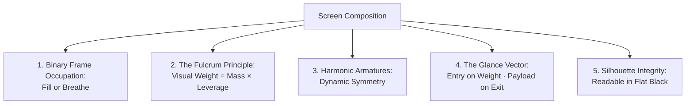

# ULTIMATE-DESIGN-SYSTEM-CANON.md
# The Unified Design System: Classical Composition, Dynamic Symmetry & The Massacre of AI Slop

> **Status:** CANON · ABSOLUTE · NON-NEGOTIABLE  
> **Authority Order:** `AGENTS.md` → Project Instructions → This File → Raw Evidence  
> **Target Audience:** All AI Agents (Claude Code, Cursor, Codex, Gemini, Copilot, Grok Bot) & Human Builders  
> **Primary Directive:** **No Slop Ships.** Eliminate Spatial Hallucination, Default AI Mush, and Meaningless Chrome.

---

## 0. THE CREED (Memorize Before Prompting or Coding)

> **"Compact first. Scroll only for interesting depth. Boxes fit content. Logos never boxed. Something must win. Eye enters on weight — payload sits on the exit. Name a grid or stay quiet. Whitespace is intentional or it is hallucinated. Builder ≠ Auditor. No slop ships."**

---

## 1. THE FOUNDATIONAL DEFINITIONS

### 1.1 Spatial Hallucination
An interface that **invents reasons for things to occupy space**, instead of arranging them around how people read, choose, and act. It looks composed at first glance, but cannot explain its own geometry.

**The Six Hallucinations:**
1. **Unjustified Gaps:** Space stretched arbitrarily to satisfy an automated container or CSS grid track.
2. **Orphan Elements:** A photo, metric, or button stranded alone beside a vast empty area.
3. **Scattered Actions:** Related buttons or interactive controls split across different rows or pushed to opposite edges.
4. **False Hierarchy:** Everything gets equal visual weight (cards of the same size, weight, and color), so nothing helps the user choose.
5. **Accidental Wrapping:** Navigation or controls break haphazardly wherever they run out of room on narrower viewports.
6. **Spatially Expensive Information:** A simple fact or decision requires an exhausting, multi-screen scroll through padded chrome.

**The Recurring Litmus Test:**
$$\mathbf{“Why\ is\ this\ here,\ why\ this\ size,\ and\ why\ this\ far\ from\ that?”}$$
If the answer is merely *“the grid put it there”* or *“to fill the container,”* **the layout has failed.**

### 1.2 AI Design Slop
A default that nobody chose: the statistical average of generic training data. It manifests as:
- Symmetrical card grids with identical visual weights ("Card Soup").
- Default AI fonts (`Inter`, `Poppins`, `Roboto`, `Montserrat`, `Open Sans`, `Lato`, `Geist`, `Space Grotesk`, naked `system-ui`).
- Decorative purple/blue gradients, glowing neon borders, glassmorphism (`backdrop-filter: blur`), and stacked drop shadows.
- Empty marketing prose (*"Unlock the power of..."*, *"Seamlessly revolutionize..."*, *"Streamline your workflow..."*).
- Fake placeholder numbers and decorative statistics.

---

## 2. THE CLASSICAL CANON: LAWS OF VISUAL GRAVITY & LEVERAGE

*(Synthesized from the 10 Classical Composition Treatises: Jacobs, StudioBinder, Gonnella, Delacruz, Hampton, Awaludin, Foster)*



### Law 1: The Binary Law of Frame Occupation — "Fill or Breathe"
Every container and visual element on a surface must strictly commit to one of two states:
1. **Fill the Frame (Content Hug / Macro-Crop):**
   - The element tightly commands its space.
   - Padding is strictly proportional to text size ($0.5\times$ to $1.5\times$ line height).
   - Control width is $\le 2\times$ content need; height is $\le 1.6\times$ content need.
   - Desktop buttons size to their labels (`width: max-content`).
2. **Breathing Space (Directional Negative Space):**
   - Generous whitespace exists *only* where the user’s eye or the subject’s gaze naturally travels.
   - It serves a defined structural job: separating distinct groups, pacing reading, or framing a focal point.

> [!CAUTION]
> **The Slop Middle Ground:** A container padded too loosely to feel intentional, yet too cramped to function as breathing room, stretched simply to balance a CSS grid. **Massacre the first expansion.**

### Law 2: The Fulcrum & Seesaw Principle of Asymmetrical Balance
Visual weight is physical gravity acting upon a central fulcrum (the viewer's center of vision):
$$\mathbf{\text{Visual Weight} = \text{Visual Mass} \times \text{Distance from Center of Vision}}$$

- **A large, quiet mass** (low-contrast ground, muted tone, large physical area) belongs **near the center**.
- **A small, dense accent** (high chroma, bold weight, critical metric) balances it from **further on the perimeter**.
- **The Seesaw Failure:** Placing a heavy hero block on one side and leaving dead, empty padding on the other without an intentional perimeter counterweight.

### Law 3: Harmonic Armatures & Dynamic Symmetry
Every viewport division must snap to a harmonic geometric ratio, never arbitrary percentages:
- **Root 1 ($\sqrt{1}$):** $1:1$ Square (stability, neutral ground).
- **Root 2 ($\sqrt{2}$):** $1:1.414$ (silver ratio, European A4/A5 measure).
- **Root 3 ($\sqrt{3}$):** $1:1.732$ (dynamic architectural tension).
- **Golden Section ($\Phi$):** $1:1.618$ ($61.8\% / 38.2\%$ division — Sanzo Wada standard).

**The Three Vectors of Intention:**
1. *Horizontal Lines:* Rest, calm, landscape, stability (data strips, reading grounds).
2. *Vertical Lines:* Dignity, structural power, permanence (instrument rails, architectural spines).
3. *Diagonal / Oblique Lines:* Action, speed, tension.  
   *(Rule: Rotated or diagonal elements are **forbidden** unless explicitly locked to a named kinetic grid).*

### Law 4: The Glance Path (Mustang over Omega)
> **The eye enters on visual weight, not DOM order. Put the payload where the eye goes next.**

```
FAIL: The Omega Pattern (Spatial Hallucination)
┌────────────────────────────────────────────────────────┐
│  Headline (Timid, 20px)                                │  <-- Skips over
├────────────────────────────────────────────────────────┤
│                                                        │
│            HEAVY DOMINANT HERO / IMAGE / MAP           │  <-- 1. Eye enters here
│                                                        │
├────────────────────────────────────────────────────────┤
│  Body Copy & Primary Action                            │  <-- Eye must leapfrog back
└────────────────────────────────────────────────────────┘

PASS: The Mustang Pattern (Natural Cognitive Flow)
┌────────────────────────────────────────────────────────┐
│                                                        │
│            HEAVY DOMINANT HERO / IMAGE / MAP           │  <-- 1. Eye enters on weight
│                                                        │
├────────────────────────────────────────────────────────┤
│  HEADLINE ON THE EXIT (Unapologetic Scale, ≥1.5-2x)    │  <-- 2. Eye drifts down
├────────────────────────────────────────────────────────┤
│  Primary Metric / Action Payload                       │  <-- 3. Eye executes action
└────────────────────────────────────────────────────────┘
```

1. **Entry = Heaviest Visual:** The map ($\ge 60\%$), full-bleed image, or enormous display metric.
2. **Payload on Natural Exit:** Headline + primary CTA sit directly adjacent to or beneath the visual exit.
3. **No Leapfrog:** Headline and copy stay unified on the same side of the visual.
4. **Keyboard Follows the Eye:** DOM Tab order must match visual glance order.

### Law 5: The Silhouette Readability Test
Black out every pixel into a pure flat black-and-white silhouette:
- If the primary action, focal point, and functional grouping are not immediately identifiable, the layout has failed.
- A silhouette consisting of a repetitive grid of identical rounded rectangles is certified slop.

---

## 3. THE 40 HARD COMMANDMENTS

### Geometry & Box Hygiene
1. **Boxes fit content:** Padding $\approx 0.5–1.5\times$ line-height. No fixed/`min-height` voids under short text. Control width $\le 2\times$ and height $\le 1.6\times$ content need.
2. **No void:** No flat empty region $> \frac{1}{3}$ of the first screen. No floating phone-width column on desktop.
3. **Compact first:** If a task fits on one screen at **390×844** and **1440×900**, make it fit. Scroll is for depth, never recovering from bloated chrome.
4. **Massacre the first expansion:** Do not decorate the downstream consequences of spatial hallucination.
5. **Something must win:** One obvious first look. Hierarchy step $\ge 1.5–2\times$ (display type $5–10\times$).
6. **Logos never boxed:** No chips, borders, pills, shadows, or backing plates behind logos. Logos sit directly on the ground.
7. **Symbols over prose:** Use compact marks (gauges, indicators, status dots) where meaning is clear. Never use emoji as UI icons.
8. **Subtract before add:** Hard caps: $\le 15$ cards, $\le 3$ shadows, **one** corner radius (or 0), $\le 5$ pills, $\le 8$ type sizes, **0** decorative gradients/glass.
9. **Map-first surgical table:** On ops/map tools, the map commands $\ge 60\%$ of the first screen; panels dock as thin edge instruments.
10. **Glance payload on exit:** Heavy visual = entry; headline and primary action sit immediately on the exit.
11. **No leapfrog:** Headline and copy stay together on one side of a dominant visual.
12. **Reject Title $\rightarrow$ Huge Image $\rightarrow$ Copy:** Use Image $\rightarrow$ Headline $\rightarrow$ Copy when the image outweighs the title.
13. **Name a grid or stay quiet:** Snap rigidly to `radial`, `axial`, `column`, or `modular`. No arbitrary `position: absolute` floating.
14. **Intentional voids push:** Empty grid modules are structural breathing room. Never plug them with filler cards or badges.

### Color, Type & Texture
15. **Quiet ground + $\le 2$ saturated accents:** Each accent has an explicit job. A data color spends an accent.
16. **Motion: snap / hard cut:** Hard cuts over dissolves. Steep ease (`cubic-bezier(0.22, 1, 0.36, 1)`). No reflex `transition-all`. No hover-scale on cards. Respect `prefers-reduced-motion`.
17. **Banned primary fonts:** `Inter`, `Poppins`, `Montserrat`, `Roboto`, `Open Sans`, `Lato`, `DM Sans`, `Space Grotesk`, `Geist`, `Plus Jakarta Sans`, `Manrope`, `Nunito`, naked `system-ui`.  
    *Approved Alternatives:* **Jost** (Bauhaus/Futura spirit), **Josefin Sans**, **League Spartan**; Thai: **Prompt** or **Kanit** (strictly non-looped); Chinese: matching geometric sans (**Noto Sans SC**). Max 2 families per product.
18. **Prose measure $\le 65\text{ch}$:** Running text strictly $45–75\text{ch}$ (Thai/Chinese: $\sim 30–45$ characters). Never allow full-width desktop paragraphs.

### Information Honesty & Rigor
19. **No filler, no fake numbers:** Ban *Unlock, Seamless, Revolutionize, Streamline, Optimize, Boost*. Zero placeholder/lorem statistics.
20. **Hero without data fails:** No hero over half the screen unless it *is* the data, map, or number.
21. **Ship basics never waived:** Text contrast $\ge 4.5:1$ (3:1 for large text); phone touch targets $\ge 44\times 44\text{px}$; every `` has truthful `alt`; explicit `<label>` tags; visible `:focus-visible`.
22. **Never invent lat/lng:** No vibe pins, no administrative centroids, no midpoints, no $0,0$.
23. **Never invent `tip_cm` / depth:** Qualitative text stays text ("knee-deep" $\neq 50\text{cm}$). Rain mm $\neq$ flood depth.
24. **No silent geocode swaps:** If a location is ambiguous, return `null` + flag for hand-pin.
25. **Gauges $\neq$ streets:** Do not relocate a localized flood to the nearest river gauge.
26. **Soft-cite honesty:** Corroborate tips before display; cite source age; never present archived snapshots as live.
27. **Style is not slop:** Deliberate aesthetic choices declared in `STYLE.md` are protected. Never strip them to pass an overzealous generic lint.
28. **Off-grid spacing fails:** Spacing values must sit on the declared scale (4px / 8px system). Reject arbitrary `mt-[13px]`.
29. **Never self-review:** Builder $\neq$ Auditor. An independent agent or human must execute the audit gate.
30. **Preserve the product:** Never "fix" an interface by deleting live maps, tickers, controls, or data.
31. **MoMA alignment:** 1px hairlines without layout theft; radius 0 by default; razor alignment.
32. **Phone chrome stays thin:** Sticky header/footer bars fit content; nav bars $\le 56\text{px}$.
33. **One primary action per screen:** Formulated as `Verb + Object`, sized to text.
34. **Stat tiles in a ruled strip:** Sized to text, never stretched equal grid tracks; a lone last tile never spans the row.
35. **No first-load modal:** Answer the user's question first. Onboarding and disclaimers wait.
36. **Light by default:** Dark mode only when designed for dark physical environments or explicitly requested in `STYLE.md`. Zero neon command-center cosplay.
37. **Triage before fixing:** Heavy / Light / None. Fix geometry and spatial hallucination before touching cosmetics.
38. **The Template Swap Test:** Paste a competitor's brand name onto your layout. If it still works, your layout is generic slop. Push further.
39. **Real visuals only:** Zero generic AI-generated hero illustrations. Real photography, authentic historical plates, or raw data.
40. **When unsure on a pin or value: NULL.** A blank state is honest. A hallucinated pin or value is a permanent scar.

---

## 4. THE SHIP GATE AUDIT CHECKLIST

Before opening a PR, merging, or claiming completion, execute this gate across **390px (Mobile)**, **1024px (Tablet)**, and **1440px (Desktop)**:

| # | Check Item | Pass Criteria | Fail Criteria (Auto-Block) |
|---|---|---|---|
| **B1** | First-Screen Task | Core fact + primary action visible without scroll at 390 & 1440 | Must scroll past empty chrome to act |
| **B2** | Chrome Cost | Nav and footer bands fit tightly; total chrome $\le 20\%$ of screen | Massive stacked identity bars consuming screen real estate |
| **B3** | Box Fit | Containers hug text ($0.5–1.5\times$ line-height padding) | Box $\gg$ text; padded empty cavities |
| **B4** | Void Purpose | Empty space has a named structural job (pause, frame, push) | Dead thirds, floating centered columns, stretch-to-fill |
| **B5** | Scroll Honesty | Additional scroll depth reveals fresh facts/actions | Scrolling through empty padding or duplicate cards |
| **B6** | Hierarchy | One unmistakable focal point; type step $\ge 1.5–2\times$ | Equal-weight card mush; squint test shows flat skyline |
| **B7** | Glance Vector | Heaviest visual = entry; headline + CTA on natural exit | Omega pattern; eye climbs upward or leapfrogs copy |
| **B8** | Proximity | Related actions grouped; distance between groups $>$ inside groups | Scattered buttons split across rows or edges |
| **B9** | Logos | Sit cleanly on the surface without enclosing container | Boxed, chipped, or shadowed logos |
| **B10** | Typography | Banned fonts absent; measure $\le 65\text{ch}$; $\le 8$ total sizes | Inter/Roboto as unexplained primary; paragraph measure $> 75\text{ch}$ |
| **B11** | Contrast & Taps | Contrast $\ge 4.5:1$; phone tap targets $\ge 44\times 44\text{px}$ | Faint grey text on grey; sub-44px clickables |
| **B12** | Independence | Audit conducted by a **different** agent or human | Self-review |

---

## 5. REFUSAL DUTY: EXACT PHRASES FOR AGENTS

When given vague directives, pressured to add filler, or asked to accept slop, use these exact phrases without softening:

1. **Refuse MSH:** *"Boxes must fit content. This element expands without a task reason — massacre the first expansion."*
2. **Refuse Void/Scroll:** *"Compact first. I will not ship a forever-scroll through empty space."*
3. **Refuse Boxed Logos:** *"Logos are never boxed. Remove the chip, border, and backing panel."*
4. **Refuse Equal Mush:** *"Nothing wins. Pick a focal point with a real type-scale step."*
5. **Refuse Glance Fail:** *"The payload must sit on the natural exit of the heavy visual. Reorder — do not rewrite first."*
6. **Refuse Leapfrog:** *"Headline and copy must stay on the same side of the dominant visual."*
7. **Refuse Unnamed Kinetic:** *"Name `radial`, `axial`, `column`, or `modular`, or stay orthogonal."*
8. **Refuse Slop Fonts:** *"That face is banned as an unexplained primary. Use the declared house face or state a STYLE.md exception."*
9. **Refuse Filler:** *"No Unlock/Seamless/Revolutionize. No fake stats."*
10. **Refuse Self-Review:** *"Builder ≠ Auditor. An independent agent must walk the audit checklist."*
11. **Refuse Map Buried:** *"Map-first: $\ge 60\%$ first screen; panels are thin instruments at the perimeter."*
12. **Refuse Reflex Motion:** *"No `transition-all`, hover-scale on cards, or idle pulses on static chrome."*
13. **Refuse Soft Adjectives:** *"‘Make it more premium’ is an unanchored directive. Give me a number, a physical material, or a named reference."*
14. **Refuse Invented Pins:** *"No coordinates without an exact geocode of the named place. Set to null."*

---

*Share this file directly with any AI agent or collaborator. Obey the canon. Builder builds. Auditor audits. No slop ships.*
